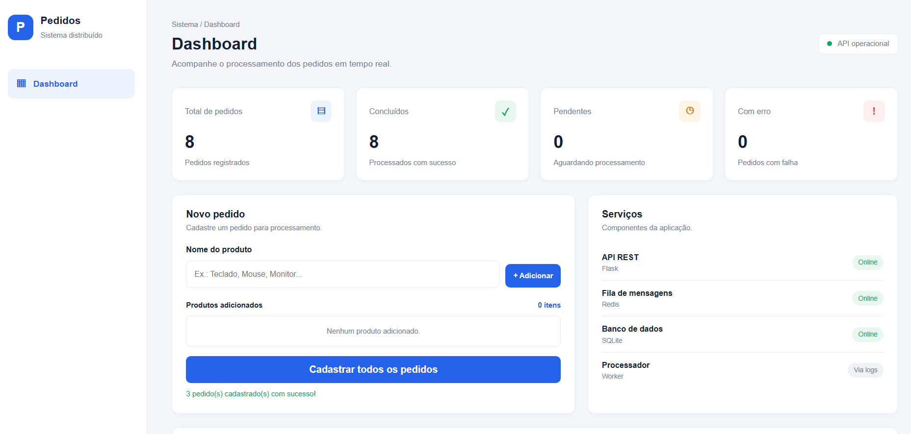

# Sistema de Processamento Distribuído de Pedidos

Aplicação distribuída desenvolvida como projeto acadêmico da disciplina de **Computação Distribuída**. O sistema permite cadastrar pedidos, armazená-los em uma fila de mensagens e realizar seu processamento de forma assíncrona, utilizando serviços independentes integrados por Docker Compose.

## Integrantes do grupo

Projeto desenvolvido pelos integrantes:

- Odair Flores Valentim
- Carlos Vinicius Braga dos Santos
- Bruna Araújo Barreto
- Lucas Junior Arteaga Yucra
**Disciplina: ** Computação Distribuída

## Dashboard

O sistema possui uma interface web para cadastrar pedidos, acompanhar seu processamento e visualizar os indicadores da aplicação.



## Funcionalidades

- Cadastro e consulta de pedidos por meio de uma API REST.
- Armazenamento de pedidos em banco de dados SQLite.
- Utilização do Redis como fila de mensagens.
- Processamento assíncrono por um Worker independente.
- Atualização automática dos estados dos pedidos.
- Dashboard com indicadores de pedidos concluídos, pendentes e com erro.
- Cadastro múltiplo de produtos pela interface.
- Consulta da disponibilidade da API, Redis e banco de dados.

## Arquitetura do sistema

A aplicação é composta por três serviços principais:

| Componente | Responsabilidade | Tecnologia |
|---|---|---|
| API | Receber e consultar pedidos | Python / Flask |
| Fila de mensagens | Armazenar pedidos aguardando processamento | Redis |
| Worker | Consumir e processar os pedidos | Python |
| Banco de dados | Persistir pedidos e resultados | SQLite |
| Interface web | Cadastro e acompanhamento dos pedidos | HTML, CSS e JavaScript |

### Fluxo de processamento

1. O usuário cadastra um ou mais pedidos pelo Dashboard.
2. A API recebe os dados e registra os pedidos no SQLite.
3. A API envia os pedidos para a fila do Redis.
4. O Worker consome os pedidos da fila.
5. O Worker realiza o processamento e atualiza o estado no banco de dados.
6. O Dashboard consulta a API periodicamente e apresenta os estados atualizados.

## Tecnologias utilizadas

- Python
- Flask
- Redis
- SQLite
- HTML5
- CSS3
- JavaScript
- Docker
- Docker Compose

## Como executar o projeto

### Pré-requisitos

Antes de iniciar, é necessário ter instalado:

- [Docker Desktop](https://www.docker.com/products/docker-desktop/)
- [Git](https://git-scm.com/) (para clonar o repositório)

### 1. Clonar o repositório

```bash
git clone https://github.com/odair-tsc/Sistema-Pedidos-Computacao-Distribuida.git
```

Entre na pasta do projeto:

```bash
cd Sistema-Pedidos-Computacao-Distribuida
```

### 2. Iniciar os serviços

Com o Docker Desktop aberto, execute:

```bash
docker compose up --build -d
```

O Docker Compose será responsável por construir as imagens e iniciar os containers da API, do Redis e do Worker.

### 3. Acessar o Dashboard

Abra o navegador no endereço:

http://localhost:5000

A partir da interface, é possível cadastrar pedidos, adicionar vários produtos à lista e acompanhar o processamento.

## Como testar a aplicação

### Verificar os serviços

```bash
docker compose ps
```

### Consultar a saúde da aplicação

```bash
curl http://localhost:5000/health
```

### Cadastrar um pedido pelo terminal

```bash
curl -X POST http://localhost:5000/pedidos \
-H "Content-Type: application/json" \
-d "{\"produto\":\"Teclado\"}"
```

### Consultar os pedidos

```bash
curl http://localhost:5000/pedidos
```

### Acompanhar os logs do Worker

```bash
docker compose logs -f worker
```

### Encerrar os serviços

```bash
docker compose down
```

Os dados persistem no volume Docker nomeado, mesmo após encerrar os containers. Para remover também o volume e os dados armazenados, seria necessário executar `docker compose down -v`. **Esse comando apaga os dados do banco.**

## Estrutura do projeto

```text
Sistema-Pedidos/
│
├── api/
│   ├── app.py
│   ├── Dockerfile
│   │
│   ├── templates/
│   │   └── index.html
│   │
│   └── static/
│       ├── css/
│       │   └── style.css
│       │
│       └── js/
│           └── app.js
│
├── worker/
│   ├── worker.py
│   └── Dockerfile
│
├── docs/
│   └── dashboard.png
│
├── docker-compose.yml
├── requirements.txt
├── .env.example
└── .gitignore
```


## Contexto 

Projeto desenvolvido para a disciplina de **Computação Distribuída**, com o objetivo de aplicar conceitos de comunicação entre serviços, processamento assíncrono, filas de mensagens, persistência de dados e conteinerização.

**Status:** desenvolvimento funcional em andamento.
